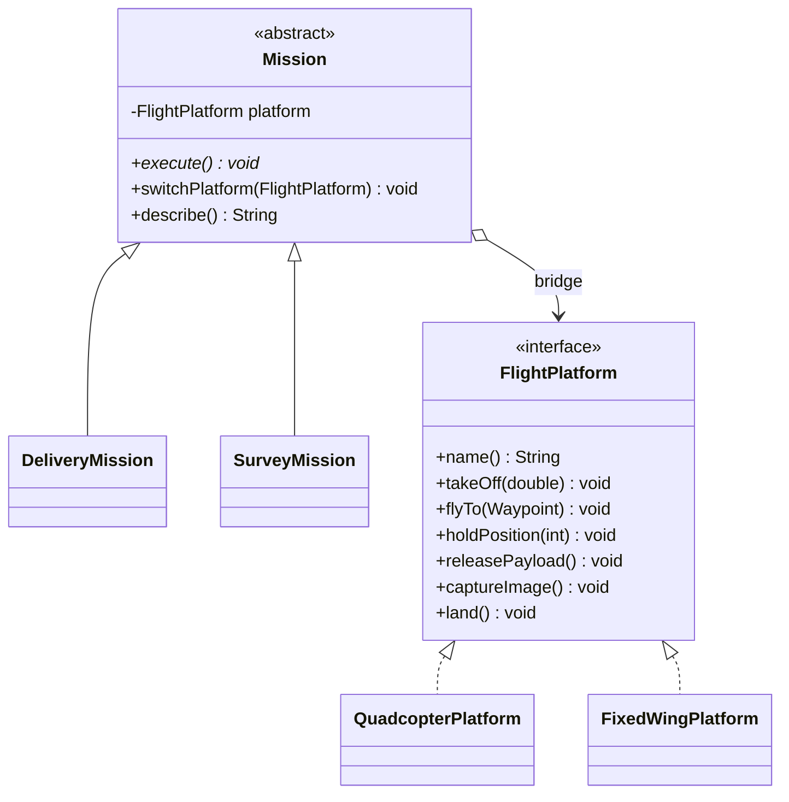

# Drone Mission Planner: Bridge pattern in Java

Assignment #3, Software Design Patterns. Author: BORANBAI DAULETKALI.

**Topic:** drone missions (delivery, survey) that can fly on different aircraft (quadcopter, fixed wing).
The mission logic and the aircraft logic vary independently, which is exactly the problem Bridge solves.

## Why Bridge?

Without Bridge, every mission type would need a subclass for every aircraft type
(`QuadcopterDeliveryMission`, `FixedWingDeliveryMission`, `QuadcopterSurveyMission`, ...), i.e. N x M classes.
With Bridge there are N + M classes: missions on one side, aircraft on the other, joined by one reference.

## Pattern roles

| Role | Class | Responsibility |
| --- | --- | --- |
| Abstraction | `Mission` (abstract class) | Holds a `FlightPlatform` reference (the bridge); defines `execute()`; allows `switchPlatform(...)` at runtime |
| Refined Abstraction 1 | `DeliveryMission` | Take off, fly to drop point, hold, release parcel, return, land |
| Refined Abstraction 2 | `SurveyMission` | Take off, fly over each waypoint taking an image, return, land |
| Implementor | `FlightPlatform` (interface) | Low-level operations: `takeOff`, `flyTo`, `holdPosition`, `releasePayload`, `captureImage`, `land` |
| Concrete Implementor 1 | `QuadcopterPlatform` | Vertical takeoff, hovers, winch for parcels |
| Concrete Implementor 2 | `FixedWingPlatform` | Runway takeoff, loiters instead of hovering, drops parcels |
| Client | `Main` | Creates missions, injects a platform, swaps it at runtime without changing the mission |

Supporting classes: `Waypoint` (immutable value object) and `FlightLog` (shared message formatting).



## Project structure

```
src/main/java/drone/
  Main.java                      Client / demo
  mission/   Mission, DeliveryMission, SurveyMission      (abstraction side)
  platform/  FlightPlatform, QuadcopterPlatform, FixedWingPlatform, FlightLog   (implementation side)
  model/     Waypoint
src/test/java/drone/BridgeTests.java   dependency-free tests
```

## How to build and run (JDK 11+)

macOS / Linux:
```
javac -d out $(find src -name "*.java")
java -cp out drone.Main
java -cp out drone.BridgeTests
```
Windows (cmd):
```
dir /s /b src\*.java > sources.txt
javac -d out @sources.txt
java -cp out drone.Main
java -cp out drone.BridgeTests
```

## Clean Code principles applied

1. **Separation of abstraction-side and implementation-side responsibilities.** `Mission` classes only decide
   the order of steps (WHAT); `FlightPlatform` classes only decide how one step is carried out (HOW).
   `Main` calls `mission.execute()` and never touches platform internals, so no implementor details leak to the client.
2. **Meaningful names that distinguish the roles.** Abstraction side is named after goals (`Mission`, `DeliveryMission`);
   implementor side is named after capabilities (`FlightPlatform`, `QuadcopterPlatform`). Methods are verbs (`takeOff`, `flyTo`).
3. **Small, focused classes (Single Responsibility).** Every class has one reason to change and is under about 60 lines;
   e.g. `FlightLog` only formats messages, `Waypoint` only holds coordinates.
4. **No duplicated logic.** The step order lives only in the missions; message formatting lives only in `FlightLog`;
   the two concrete platforms differ solely in real aircraft behavior (hover vs. loiter, winch vs. belly hatch).
5. **Open/Closed and backward compatibility.** A new aircraft (e.g. `HelicopterPlatform implements FlightPlatform`) or a
   new mission (e.g. `PatrolMission extends Mission`) is added without editing any existing class.
6. **Composition over inheritance and dependency on abstractions.** `Mission` depends on the `FlightPlatform` interface,
   not on a concrete class; the implementation is injected through the constructor and can be replaced with `switchPlatform`.
7. **Fail fast and immutability.** Constructors reject `null` and an empty survey route; `Waypoint` is immutable and
   `SurveyMission` stores an unmodifiable defensive copy of the route.
8. **No magic numbers.** Altitudes and hold time are named constants (`CRUISE_ALTITUDE_M`, `SURVEY_ALTITUDE_M`, `DROP_HOLD_SECONDS`).

## Tests

`BridgeTests` uses a `RecordingPlatform` test double (a third Implementor) to prove that missions delegate the correct
steps in order, that switching the platform keeps the abstraction unchanged, that the two real platforms behave
differently for the same mission, and that invalid arguments are rejected.
